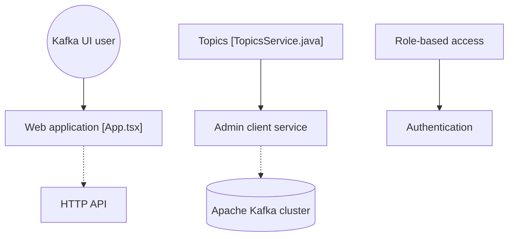

# provectus/kafka-ui

> Interface web pour surveiller et administrer des clusters Apache Kafka, destinée aux équipes qui exploitent Kafka.

## Le problème
Inspecter brokers, topics, groupes de consommateurs et messages Kafka en ligne de commande est lent et peu lisible.

## Ce que ça fait vraiment
Une application web qui gère plusieurs clusters : brokers, topics, partitions, lag des consumer groups, navigation et production de messages (JSON, texte, Avro), schema registry, Kafka Connect, ksqlDB. Elle ajoute authentification OAuth, contrôle d'accès par rôles et masquage de données.

## Comment c'est branché


## Essayer
```bash
docker run -it -p 8080:8080 -e DYNAMIC_CONFIG_ENABLED=true provectuslabs/kafka-ui
# puis http://localhost:8080
```

## Coût et pièges
Gratuit, mais il faut un cluster Kafka à interroger. Dernier push en juillet 2024 et 352 issues ouvertes : suivi à vérifier.

## Ce que ce n'est pas
Pas un outil de supervision complet : il montre l'état et agit, il ne remplace ni Prometheus ni un système d'alerte.

## Alternatives
Aucune alternative nommée dans le README.

## Pour toi
À surveiller : utile si tes pipelines de données passent par Kafka, mais le dépôt n'a plus de push depuis juillet 2024.

