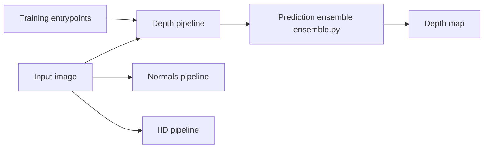

# prs-eth/Marigold

> Diffusion models adapted to estimate depth, normals and intrinsic decomposition of an image, for computer vision.

## The problem
Estimating monocular depth or normals requires large annotated datasets; out-of-domain generalization is difficult.

## What it actually does
Fine-tunes Stable Diffusion with little synthetic data to produce depth maps, normals and intrinsic components (appearance, lighting), with zero-shot generalization. Inference, evaluation and training scripts; prediction ensembling and uncertainty. Also integrated into diffusers and available through Hugging Face demos.

## How it is wired


## Trying it
```bash
git clone https://github.com/prs-eth/Marigold.git
cd Marigold
python -m venv venv/marigold
source venv/marigold/bin/activate
pip install -r requirements.txt
bash script/download_sample_data.sh
python script/depth/run.py --checkpoint prs-eth/marigold-depth-v1-1 --input_rgb_dir input/in-the-wild_example --output_dir output/in-the-wild_example --fp16
```

## Cost and gotchas
Tested on Ubuntu 22.04, CUDA 11.7, RTX 3090; an `--apple_silicon` mode exists. Results may differ slightly between hardware despite the seed.

## What it is not
Not a real-time model: it is diffusion, with several passes. Training requires preparing Hypersim, Virtual KITTI 2, etc.

## Alternatives
No alternative named in the README.

## For you
Adopt it if you do 3D vision or perception: an academic reference (CVPR 2024), Apache 2.0, complete code from inference to training.
