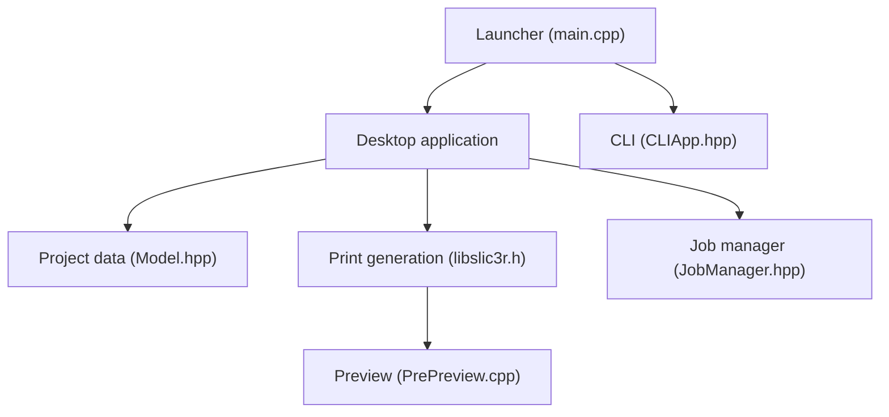

# prusa3d/PrusaSlicer

> 3D slicing software that generates print instructions for FDM and mSLA printers.

## The problem
A 3D model has to be converted into layers and instructions the printer understands.

## What it actually does
Prepares the model (painting, cutting, arrangement), tunes settings down to the layer, handles multiple projects and plates, multi-material, 3D preview, and sends the job to the printer. Command-line interface for automation. Optional integration with PrusaConnect and Printables. Written in C++20.

## How it is wired


## Trying it
```bash
# Aucune commande documentée : téléchargement depuis la page du projet ou GitHub Releases ; sous Linux, Flathub.
```

## Cost and gotchas
Free. AGPL-3.0 license. On Linux, distributed only through Flathub. 938 open issues.

## What it is not
Not a 3D modeling tool: it prepares printing. The online integrations are optional.

## Alternatives
Slic3r, from which PrusaSlicer originated. The README names no other alternative.

## For you
Ignore: 3D printing, unrelated to data / AI / MLOps work.
