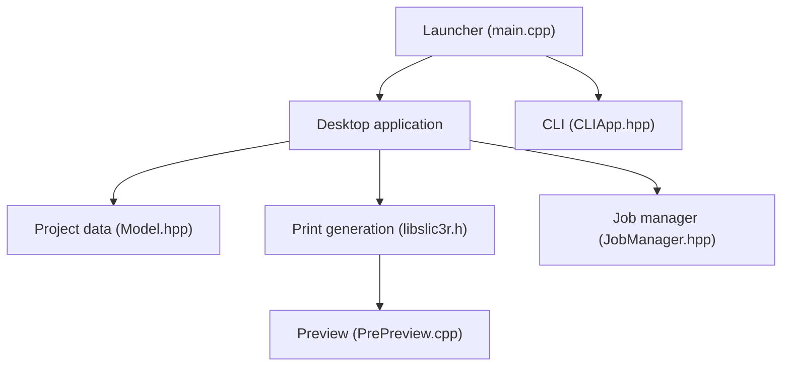

# prusa3d/PrusaSlicer

> Logiciel de découpe 3D qui génère les instructions d'impression pour imprimantes FDM et mSLA.

## Le problème
Un modèle 3D doit être converti en couches et en instructions que l'imprimante comprend.

## Ce que ça fait vraiment
Prépare le modèle (peinture, découpe, disposition), règle les paramètres jusqu'à la couche, gère plusieurs projets et plateaux, le multi-matériaux, l'aperçu 3D, et envoie le travail à l'imprimante. Interface en ligne de commande pour l'automatisation. Intégration optionnelle avec PrusaConnect et Printables. Écrit en C++20.

## Comment c'est branché


## Essayer
```bash
# Aucune commande documentée : téléchargement depuis la page du projet ou GitHub Releases ; sous Linux, Flathub.
```

## Coût et pièges
Gratuit. Licence AGPL-3.0. Sous Linux, distribution seulement par Flathub. 938 issues ouvertes.

## Ce que ce n'est pas
Pas un outil de modélisation 3D : il prépare l'impression. Les intégrations en ligne sont facultatives.

## Alternatives
Slic3r, dont PrusaSlicer est issu. Le README ne nomme pas d'autre alternative.

## Pour toi
À ignorer : impression 3D, sans lien avec un travail data / IA / MLOps.

