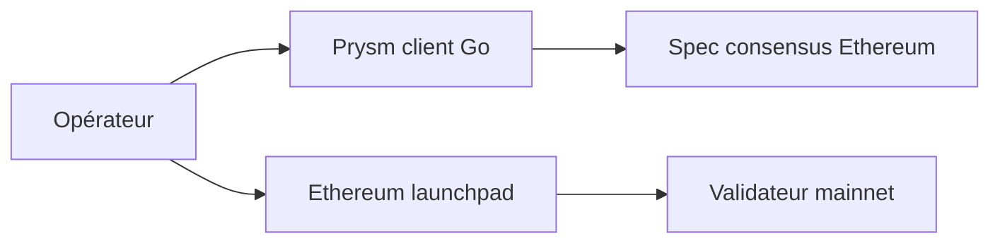

# prysmaticlabs/prysm

> Go implementation of Ethereum consensus, developed by Offchain Labs, for node operators and validators.

## The problem
Taking part in Ethereum consensus requires a consensus client that complies with the specification.

## What it actually does
The README does not describe how it works: it points to the online documentation, the changelog, Discord and the Ethereum launchpad for staking. Two branches: `master` (stable) and `develop`. Instructions for coding agents are in `.agents/AGENTS.md`. No architecture diagram provided.

## How it is wired

Diagram limited to the README, no code described.

## Trying it
```bash
echo '@.agents/AGENTS.md' > ./AGENTS.md
```
This is the only command in the README; installation is in the online documentation.

## Cost and gotchas
Free, but staking commits funds (not detailed here). 599 open issues. Last push on 2026-09-29.

## What it is not
Not a wallet or a trading tool. Not useful for data/AI.

## Alternatives
No alternative named in the README.

## For you
Ignore: blockchain infrastructure unrelated to data/AI/MLOps.
