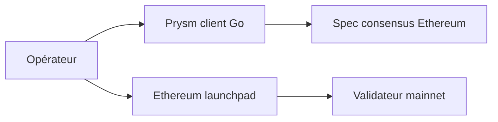

# prysmaticlabs/prysm

> Implémentation en Go du consensus Ethereum, développée par Offchain Labs, pour opérateurs de nœuds et validateurs.

## Le problème
Participer au consensus Ethereum exige un client de consensus conforme à la spécification.

## Ce que ça fait vraiment
Le README ne décrit pas le fonctionnement : il renvoie à la documentation en ligne, au changelog, au Discord et au launchpad Ethereum pour le staking. Deux branches : `master` (stable) et `develop`. Des instructions pour agents de code se trouvent dans `.agents/AGENTS.md`. Aucun diagramme d'architecture fourni.

## Comment c'est branché

Schéma limité au README, sans code décrit.

## Essayer
```bash
echo '@.agents/AGENTS.md' > ./AGENTS.md
```
C'est la seule commande du README ; l'installation est dans la documentation en ligne.

## Coût et pièges
Gratuit, mais le staking engage des fonds (non détaillés ici). 599 issues ouvertes. Dernier push le 2026-09-29.

## Ce que ce n'est pas
Pas un portefeuille ni un outil de trading. Pas utile pour data/IA.

## Alternatives
Aucune alternative nommée dans le README.

## Pour toi
Ignorer : infrastructure blockchain sans lien avec data/IA/MLOps.

