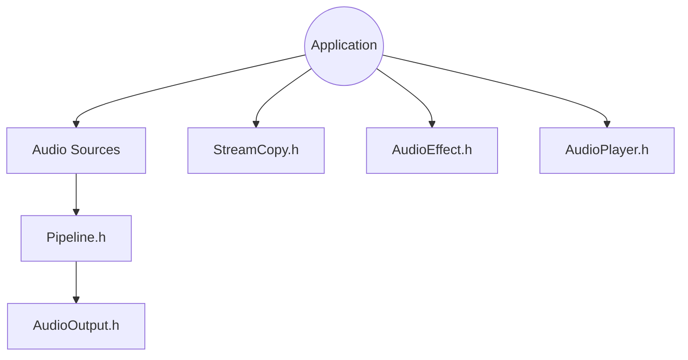

# pschatzmann/arduino-audio-tools

> C++ classes for processing audio on Arduino and ESP32, with sources, outputs, codecs and effects.

## The problem
Connecting a microphone, a file or a network to an I2S or USB output requires manually gluing together codec and filter libraries.

## What it actually does
A header-only C++ library built on Arduino streams: you read from a source, decode or transform, and write to an output. It provides codecs (MP3, AAC, WAV, FLAC), sound generators, effects, a three-band equalizer, an audio and video player, USB audio, and a build mode for Linux, Windows and macOS.

## How it is wired


## Trying it
```bash
cd  ~/Documents/Arduino/libraries
git clone https://github.com/pschatzmann/arduino-audio-tools.git
git pull
```

## Cost and gotchas
Free. A compatible board is needed, and sometimes extra libraries depending on the example. Logging goes to Serial; it can be disabled with `USE_AUDIO_LOGGING` to save memory.

## What it is not
Not a ready-to-use application: a set of building blocks to assemble in a sketch. Not audio AI: it is embedded signal processing.

## Alternatives
None cited in the README.

## For you
Ignore: excellent for embedded audio, but outside the data / AI / MLOps scope, and under GPL-3.0 so restrictive to integrate.
