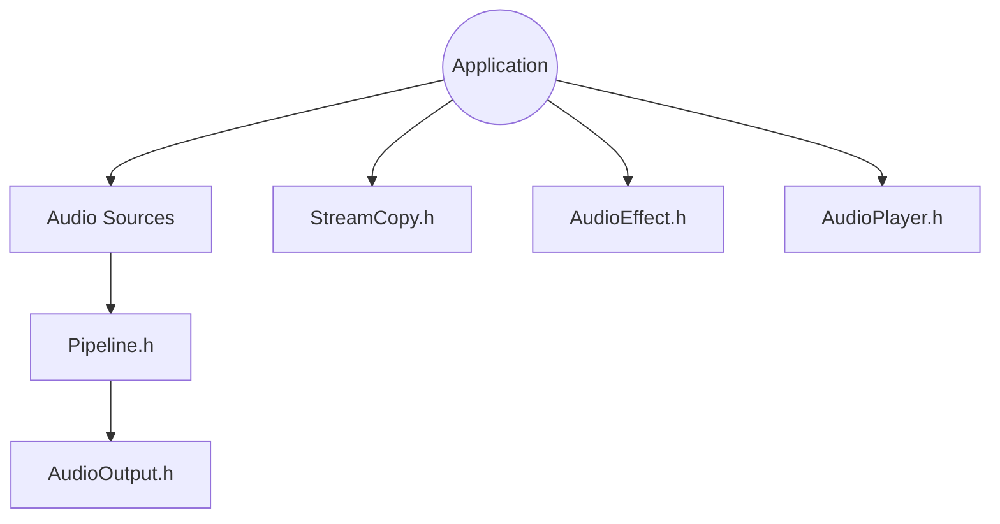

# pschatzmann/arduino-audio-tools

> Classes C++ pour traiter l'audio sur Arduino et ESP32, avec sources, sorties, codecs et effets.

## Le problème
Brancher un micro, un fichier ou un réseau sur une sortie I2S ou USB demande de recoller à la main des bibliothèques de codecs et de filtres.

## Ce que ça fait vraiment
Une bibliothèque C++ en en-têtes, construite sur les flux Arduino : on lit depuis une source, on décode ou transforme, on écrit vers une sortie. Elle fournit codecs (MP3, AAC, WAV, FLAC), générateurs de sons, effets, égaliseur trois bandes, lecteur audio et vidéo, audio USB, et un mode de compilation pour Linux, Windows et macOS.

## Comment c'est branché


## Essayer
```bash
cd  ~/Documents/Arduino/libraries
git clone https://github.com/pschatzmann/arduino-audio-tools.git
git pull
```

## Coût et pièges
Gratuit. Il faut une carte compatible et parfois des bibliothèques supplémentaires selon l'exemple. La journalisation part sur Serial ; elle se désactive avec `USE_AUDIO_LOGGING` pour économiser de la mémoire.

## Ce que ce n'est pas
Pas une application prête à l'emploi : un jeu de briques à assembler dans un sketch. Pas de l'IA audio : c'est du traitement du signal embarqué.

## Alternatives
Aucune citée dans le README.

## Pour toi
À ignorer : excellent pour de l'audio embarqué, mais hors du périmètre data / IA / MLOps, et sous GPL-3.0 donc contraignant à intégrer.

