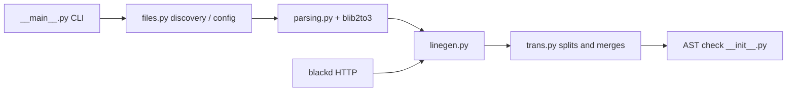

# psf/black

> Uncompromising Python code formatter that ends style debates, for Python teams.

## The problem
Code reviews get bogged down in formatting discussions, and every project formats in its own way.

## What it actually does
Black rewrites whole Python files in a single, deterministic style, leaving few options. It reads its configuration from `pyproject.toml`, applies include and exclude rules, caches unchanged files and formats in parallel. Except with `--fast`, it checks that the reformatted code has an AST equivalent to the original. It also handles Jupyter notebooks, `blackd` (HTTP daemon) and a GitHub Action.

## How it is wired


## Trying it
```bash
pip install black
pip install "black[jupyter]"
black {source_file_or_directory}
python -m black {source_file_or_directory}
```

## Cost and gotchas
Free; Python 3.10+ required. `--fast` skips the equivalence check, which is otherwise slower. What looks like a bug is sometimes intended behavior, to be checked in the style documentation.

## What it is not
Neither a linter nor a refactoring tool: it only formats the visual aspect of files. It is deliberately almost not configurable.

## Alternatives
- No alternative named in the README (pycodestyle appears there only as a source of style remarks).

## For you
Adopt: the de facto standard for data/AI Python code, it makes pull requests and notebooks (`black[jupyter]`) uniform with no configuration effort.
