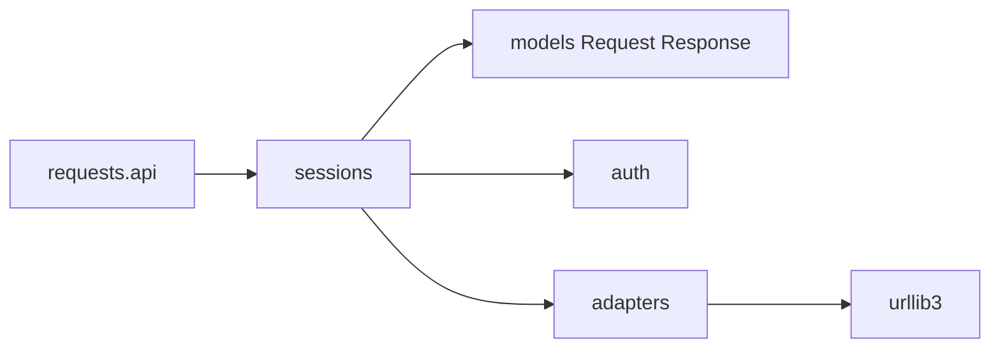

# psf/requests

> Python HTTP library for sending web requests with very little code.

## The problem
Calling an HTTP API with the standard library requires encoding parameters, body and authentication yourself.

## What it actually does
`requests` sends HTTP/1.1 requests, handles authentication, sessions and cookies, response encoding and JSON (`r.json()`). The README states about 300 million downloads per week and more than 4,000,000 dependent repositories. The code relies on urllib3 for transport.

## How it is wired


## Trying it
```python
import requests
r = requests.get('https://httpbin.org/basic-auth/user/pass', auth=('user', 'pass'))
r.status_code
r.json()
```
```bash
git clone -c fetch.fsck.badTimezone=ignore https://github.com/psf/requests.git
```

## Cost and gotchas
Free. Cloning the repository may require `-c fetch.fsck.badTimezone=ignore`. The README does not explain installation with pip.

## What it is not
It is not an asynchronous client: the README only mentions synchronous calls.

## Alternatives
No alternative named in the README.

## For you
Adopt: standard building block for calling data and model APIs from Python.
