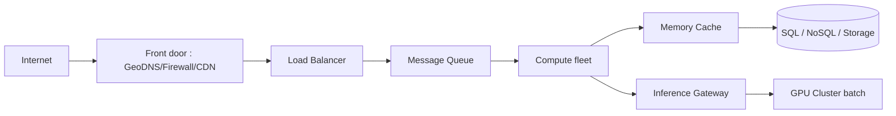

# pshenok/server-survival

> 3D simulation game where you play a Cloud Architect building a resilient infrastructure.

## The problem
Cloud architecture concepts (autoscaling, circuit breaking, failover, inference batching) remain abstract unless you handle them hands-on.

## What it actually does
Each mechanic is a real cloud concept in miniature: observability, auto-scaling and cold start, queue-depth scaling, circuit breaking, multi-region failover, inference serving with GPU batching, inference SLOs, power as a constraint, OLTP vs OLAP. Survival, Campaign (25 levels, including a chapter "The AI Wave" on GPU inference) and Sandbox (26 services) modes. PNG export and shareable URL of the architecture. Three.js, vanilla JavaScript, served by GitHub Pages.

## How it is wired


## Trying it
```bash
git clone https://github.com/pshenok/server-survival.git
cd server-survival
python3 -m http.server 8000
```

## Cost and gotchas
Free, playable online without installation. To run your own copy, serve the folder (ES modules are blocked on `file://`). No account.

## What it is not
Not a production tool: an educational game. The values (costs, capacities) are playful, not real references.

## Alternatives
- Datacenter Survival: sister game (same author) on the physical layer.

## For you
Fun for reviewing cloud/inference architecture concepts in a playful way; no direct operational value — ignore on the tooling side.
