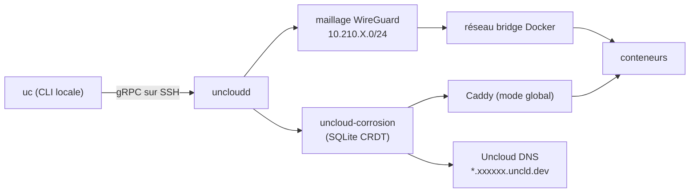

# psviderski/uncloud

> Container orchestrator without a control plane, for deploying web apps on your own machines.

## The problem
Deploying on three VPSs rented from three providers means either paying for a PaaS or setting up a Kubernetes whose control plane and quorum must be maintained for three containers.

## What it actually does
Installs Docker and an `uncloudd` daemon on each machine via SSH, and sets up a WireGuard mesh with one subnet per machine (`10.210.X.0/24`). The cluster state is replicated by `corrosion`, a distributed SQLite database using CRDTs: each machine has a full copy, so any of them serves as an entry point. A Caddy in `global` mode on each node watches this state and routes HTTPS traffic. Services are described in Docker Compose, not in a home-made DSL.

## How it is wired


## Trying it
```bash
brew install psviderski/tap/uncloud
# ou : curl -fsS https://get.uncloud.run/install.sh | sh
uc machine init root@your-server-ip
uc run -p app.example.com:8000/https image/my-app
uc machine add --name hetzner-server root@5.223.45.199
uc ls
uc rm my-app-name
```

## Cost and gotchas
Free, but you need your own servers and a DNS A record to create by hand. The `*.cluster.uncloud.run` domain goes through Uncloud's managed DNS service, hence an external dependency.

## What it is not
Not a Kubernetes: no state reconciliation, the approach is imperative and openly so. Not stable either: pre-1.0, with breaking changes announced between versions. Automatic rollback on deployment failure is announced as "coming soon", so absent.

## Alternatives
- Kubernetes: if the quorum and complex YAMLs are already in place and mastered.
- Heroku / Render: cited by the README as the experience to match, without the ops.
- Docker Compose alone: sufficient as long as you stay on one machine.

## For you
Worth a look if you host your own demos or scoring services; too young for data production.
