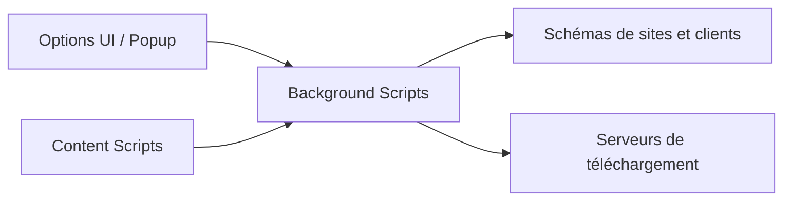

# pt-plugins/PT-Plugin-Plus

> Browser extension for private torrent sites: one-click sending to a download client.

## The problem
Using private trackers means copying links and configuring each site and download server.

## What it actually does
Sends torrents to Transmission, Synology Download Station, µTorrent, Deluge, qBittorrent, ruTorrent, Flood; aggregated multi-site search; batch downloading; Douban and IMDb integrations. The README announces the end of maintenance and recommends PT-depiler.

## How it is wired


## Trying it
```bash
# Aucune commande dans le README : installation décrite dans le Wiki
```

## Cost and gotchas
Free; requires accounts on private trackers. Manifest V2 is end-of-life: the extension may be disabled by Chrome.

## What it is not
A maintained project: archived, with a named successor.

## Alternatives
PT-depiler, the successor recommended by the README.

## For you
Ignore: archived and unrelated to data/AI/MLOps.
