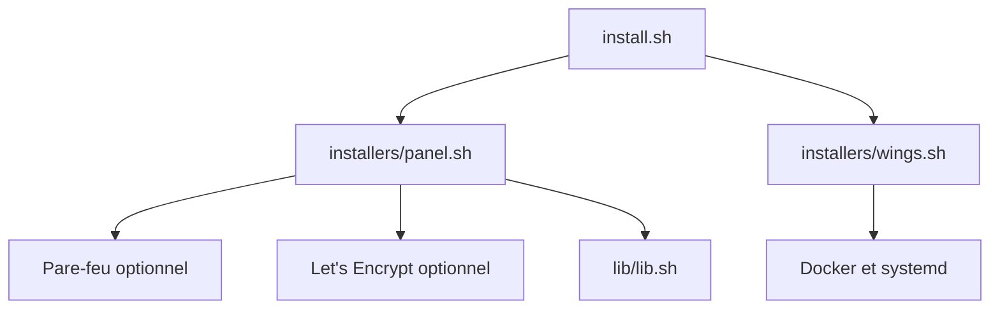

# pterodactyl-installer/pterodactyl-installer

> Unofficial Bash scripts to install the Pterodactyl Panel and Wings on a Linux server.

## The problem
Installing the Pterodactyl game server management panel and its Wings agent is long: dependencies, database, nginx, Docker.

## What it actually does
A script asks whether to install the Panel, Wings or both, then sets up dependencies, database, cron and nginx for the Panel, and Docker and systemd for Wings. Let's Encrypt and firewall are optional, uninstallation is provided, and Panel v2 support is in preview.

## How it is wired


## Trying it
```bash
bash <(curl -s https://pterodactyl-installer.se)
vagrant up
```

## Cost and gotchas
Runs as root on Debian, Ubuntu, AlmaLinux or Rocky. Running a remote script as root is a risk: read it first.

## What it is not
Not affiliated with the official Pterodactyl project. Does not handle running the game servers.

## Alternatives
- Official Pterodactyl: manual installation documentation is cited.

## For you
Ignore: game server installation, unrelated to data/AI/MLOps.
