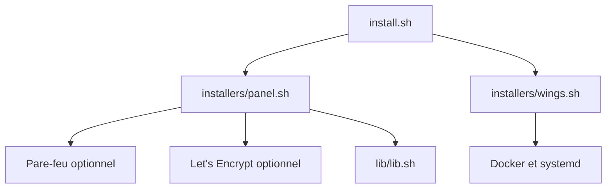

# pterodactyl-installer/pterodactyl-installer

> Scripts Bash non officiels pour installer le Panel et Wings de Pterodactyl sur un serveur Linux.

## Le problème
Installer le panneau de gestion de serveurs de jeux Pterodactyl et son agent Wings est long : dépendances, base, nginx, Docker.

## Ce que ça fait vraiment
Un script demande s'il faut installer le Panel, Wings ou les deux, puis configure dépendances, base de données, cron et nginx pour le Panel, Docker et systemd pour Wings. Let's Encrypt et pare-feu en option, désinstallation prévue, support Panel v2 en préversion.

## Comment c'est branché


## Essayer
```bash
bash <(curl -s https://pterodactyl-installer.se)
vagrant up
```

## Coût et pièges
Se lance en root sur un système Debian, Ubuntu, AlmaLinux ou Rocky. Exécuter un script distant en root est un risque : relis-le avant.

## Ce que ce n'est pas
Pas associé au projet Pterodactyl officiel. Ne gère pas l'exploitation des serveurs de jeux.

## Alternatives
- Pterodactyl officiel : documentation d'installation manuelle citée.

## Pour toi
Ignorer : installation de serveurs de jeux, sans lien avec data/IA/MLOps.

