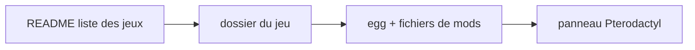

# pterodactyl/game-eggs

> Catalog of "egg" configurations for hosting game servers on the Pterodactyl panel.

## The problem
Configuring a dedicated game server (installation, variables, startup) by hand for each game is tedious.

## What it actually does
The README lists, by category, more than a hundred games (ARK, Minecraft and its variants, Rust, GTA, Counter-Strike, etc.), each with its configuration folder and its mod files. The internal workings of an egg are not described in the provided README: not documented here.

## How it is wired

Diagram deduced from the README text, no diagram provided.

## Trying it
No command documented in the provided README. You have to open the folder of the desired game and follow its instructions.

## Cost and gotchas
Assumes a Pterodactyl panel is already installed (not described here) and a server to host the games. 245 open issues.

## What it is not
Not the Pterodactyl panel itself, only configurations. No link with data or AI.

## Alternatives
No alternative named in the README.

## For you
Ignore: game server hosting, unrelated to a data / AI / MLOps profile.
