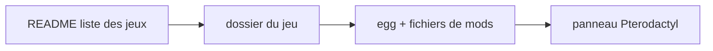

# pterodactyl/game-eggs

> Catalogue de configurations « eggs » pour héberger des serveurs de jeux sur le panneau Pterodactyl.

## Le problème
Configurer un serveur de jeu dédié (installation, variables, démarrage) à la main pour chaque jeu est fastidieux.

## Ce que ça fait vraiment
Le README liste par catégorie plus d'une centaine de jeux (ARK, Minecraft et ses variantes, Rust, GTA, Counter-Strike, etc.), chacun avec son dossier de configuration et ses fichiers de mods. Le fonctionnement interne d'un egg n'est pas décrit dans le README fourni : non documenté ici.

## Comment c'est branché

Schéma déduit du texte du README, aucun diagramme fourni.

## Essayer
Aucune commande documentée dans le README fourni. Il faut ouvrir le dossier du jeu voulu et suivre ses instructions.

## Coût et pièges
Suppose un panneau Pterodactyl déjà installé (non décrit ici) et un serveur pour héberger les jeux. 245 issues ouvertes.

## Ce que ce n'est pas
Pas le panneau Pterodactyl lui-même, seulement des configurations. Aucun lien avec la data ou l'IA.

## Alternatives
Aucune alternative nommée dans le README.

## Pour toi
Ignorer : hébergement de serveurs de jeux, sans rapport avec un profil data / IA / MLOps.

