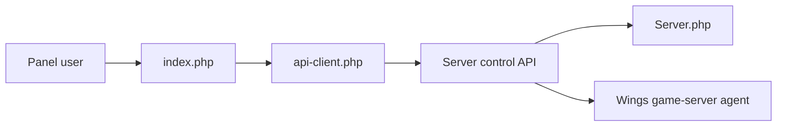

# pterodactyl/panel

> Web panel for managing game servers, running them in isolated Docker containers.

## The problem
Hosting and administering several game servers for users without giving them system access.

## What it actually does
PHP (Laravel) application: accounts, servers, nodes, "eggs" (configurations), allocations, backups, databases, schedules, subusers and permissions, activity log. Game servers run through the Wings agent. v2 is in beta (`2.0-develop` branch), v1 remains the stable branch.

## How it is wired

## Trying it
No command documented in the README: it points to the panel and Wings documentation.

## Cost and gotchas
Free. The README announces the MIT license for v2, but GitHub does not identify it: to be verified. You need a Wings node with Docker in addition to the panel.

## What it is not
Not a general container orchestrator: it is designed for game servers.

## Alternatives
No alternative named in the README.

## For you
Ignore: a game-server administration panel, outside the scope of data, AI and MLOps. Of no interest for your work.
