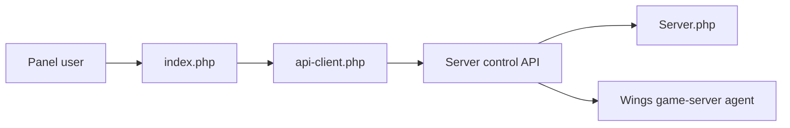

# pterodactyl/panel

> Panneau web de gestion de serveurs de jeux, qui les fait tourner dans des conteneurs Docker isolés.

## Le problème
Héberger et administrer plusieurs serveurs de jeux pour des utilisateurs sans leur donner un accès système.

## Ce que ça fait vraiment
Application PHP (Laravel) : comptes, serveurs, nœuds, « eggs » (configurations), allocations, sauvegardes, bases de données, planifications, sous-utilisateurs et permissions, journal d'activité. Les serveurs de jeux s'exécutent via l'agent Wings. La v2 est en bêta (branche `2.0-develop`), la v1 reste la branche stable.

## Comment c'est branché

## Essayer
Aucune commande documentée dans le README : il renvoie à la documentation du panel et de Wings.

## Coût et pièges
Gratuit. Le README annonce la licence MIT pour la v2, mais GitHub ne l'identifie pas : à vérifier. Il faut un nœud Wings avec Docker en plus du panel.

## Ce que ce n'est pas
Pas un orchestrateur général de conteneurs : il est conçu pour les serveurs de jeux.

## Alternatives
Aucune alternative nommée dans le README.

## Pour toi
Ignorer : hors périmètre data/IA/MLOps.

