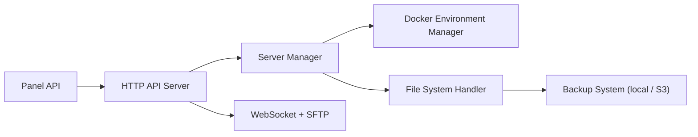

# pterodactyl/wings

> Pterodactyl's game server control daemon, with an HTTP API and built-in SFTP.

## The problem
A game server hosting panel needs an agent on each machine to drive the containers.

## What it actually does
Exposes an HTTP API to act on servers (lifecycle, logs, backups), a WebSocket, and a built-in SFTP using the same credentials as the panel. According to the generated diagram: Docker driver, file system, local or S3 backups, transfers, events. Issues are filed on the pterodactyl/panel repository.

## How it is wired

## Trying it
No command in the README; installation through the Wings documentation (link).

## Cost and gotchas
Requires the Pterodactyl panel and Docker. S3 backups are a third-party service. No GPU or API prerequisite.

## What it is not
Not usable on its own: it is the Pterodactyl panel's agent. It is not a data or AI tool.

## Alternatives
The README names no alternative.

## For you
Ignore: game server hosting, unrelated to a data/AI/MLOps profile.
