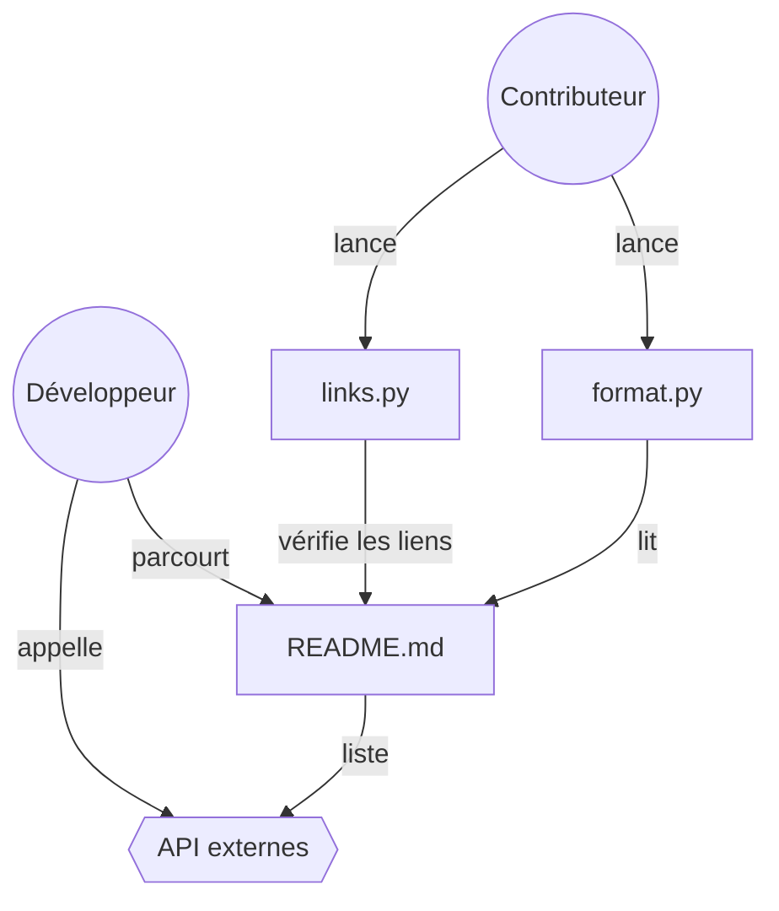

# public-apis/public-apis

> A community-maintained list of public APIs, categorized and including authentication, HTTPS, and CORS support, for developers.

## The problem
Finding a free API for a prototype (e.g., weather, geocoding, open data) requires searching the web, but it's often unclear whether the API requires a key or supports CORS (Cross-Origin Resource Sharing).

## What it actually does
A comprehensive README, organized into approximately 50 categories (Animals, Finance, Machine Learning, Weather, etc.). Each line provides information on the description, authentication type, HTTPS, and CORS. A section for MCP Servers also lists servers for agents, along with transport and installation locations. The code focuses on format and link validation for contributors.

## How it is wired


## Trying it
```bash
# Aucune commande documentée dans le README : on le lit et on ouvre le site publicapis.lol.
```

## Cost and gotchas
The service is free, but each API listed has its own quotas and its own key. The beginning of the README highlights APILayer, which is a commercial product.

## What it is not
This is not a client or an SDK: no APIs are implemented here. The entries are not guaranteed to be up-to-date; the list is manually maintained.

## Alternatives
No alternative is specified in the README, except for the public website apis.lol, which replicates the content with a search function.

## For you
To use as a bookmark for finding a prototype data source, but without needing to install or closely monitor anything.
