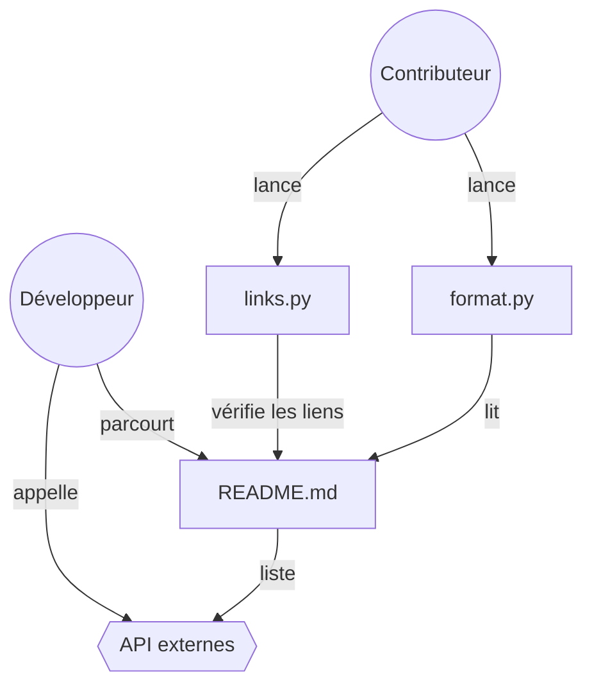

# public-apis/public-apis

> Liste communautaire d'API publiques classées par catégorie, avec authentification, HTTPS et CORS, pour développeurs.

## Le problème
Trouver une API gratuite pour un prototype (météo, géocodage, données ouvertes) oblige à fouiller le web sans savoir si elle exige une clé ou accepte le CORS.

## Ce que ça fait vraiment
Un README géant, rangé en une cinquantaine de catégories (Animals, Finance, Machine Learning, Weather…). Chaque ligne donne description, type d'authentification, HTTPS et CORS. Une section MCP Servers liste aussi des serveurs pour agents avec transport et lieux d'installation. Le code se limite à des validateurs de format et de liens pour les contributeurs.

## Comment c'est branché


## Essayer
```bash
# Aucune commande documentée dans le README : on le lit et on ouvre le site publicapis.lol.
```

## Coût et pièges
Le dépôt est gratuit, mais chaque API listée a ses propres quotas et sa propre clé. Le début du README met en avant la suite APILayer, qui est commerciale.

## Ce que ce n'est pas
Ce n'est pas un client ni un SDK : aucune API n'est implémentée ici. Les entrées ne sont pas garanties vivantes ; la liste est rédigée à la main.

## Alternatives
Aucune alternative nommée dans le README, hormis le site publicapis.lol qui en reprend le contenu avec recherche.

## Pour toi
À garder en marque-page pour dénicher une source de données de prototype, mais sans rien à installer ni à suivre de près.

