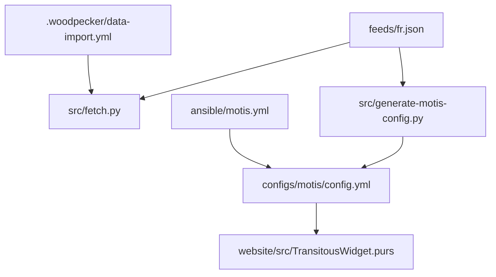

# public-transport/transitous

> Free community service for public transport route planning, fed by open GTFS feeds.

## The problem
International transport routes depend on operators and do not cross borders.

## What it actually does
Collects the GTFS / GTFS-RT feeds listed in `feeds/*.json`, fixes them with Lua scripts, then generates the MOTIS engine configuration. Deployment goes through Woodpecker and Ansible; a Hugo site exposes a search widget. Goals: free of charge, privacy, collaborative maintenance of feeds.

## How it is wired


## Trying it
```bash
# Aucune commande dans le README : consulter le site du projet pour ajouter une région.
```

## Cost and gotchas
Free to use. Contributing requires maintaining data feeds. No license in the repository (the header comment mentions CC0-1.0 for the README only).

## What it is not
Not an operator's product: coverage depends on the open feeds available.

## Alternatives
No alternative named in the README.

## For you
Nice open-data pipeline case (GTFS), but outside your core field: worth watching.
