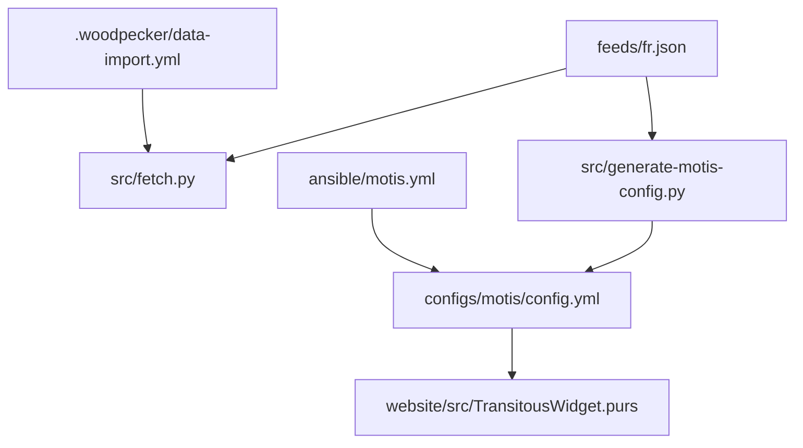

# public-transport/transitous

> Service communautaire gratuit de calcul d'itinéraires en transports publics, alimenté par des flux GTFS ouverts.

## Le problème
Les itinéraires de transport international dépendent des opérateurs et ne passent pas les frontières.

## Ce que ça fait vraiment
Collecte des flux GTFS / GTFS-RT listés dans `feeds/*.json`, les corrige par des scripts Lua puis génère la configuration du moteur MOTIS. Le déploiement passe par Woodpecker et Ansible ; un site Hugo expose un widget de recherche. Objectifs : gratuité, vie privée, maintenance collaborative des flux.

## Comment c'est branché


## Essayer
```bash
# Aucune commande dans le README : consulter le site du projet pour ajouter une région.
```

## Coût et pièges
Gratuit à utiliser. Contribuer demande de maintenir des flux de données. Licence absente du dépôt (le commentaire de tête mentionne CC0-1.0 pour le README seulement).

## Ce que ce n'est pas
Pas un produit d'un opérateur : couverture dépendante des flux ouverts disponibles.

## Alternatives
Aucune alternative nommée dans le README.

## Pour toi
Beau cas de pipeline de données ouvertes (GTFS), mais hors cœur de métier : à surveiller.

