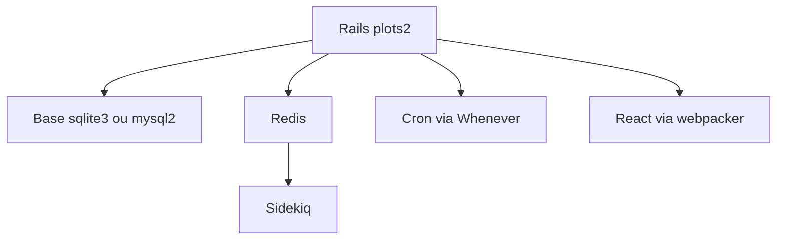

# publiclab/plots2

> Rails application of the Public Lab community, combining a research blog, a wiki and Q&A.

## The problem
An environmental research community needs a space to publish notes, documentation and discussions.

## What it actually does
Manages research notes, a wiki with revisions, tags and groups, Q&A, email notifications, search via an API, a Leaflet location map and internationalization. Rewritten in Rails in 2012 but it keeps the original Drupal data model.

## How it is wired
Simplified diagram based on the sheet, no diagram provided.



## Trying it
```bash
bundle install
cp db/schema.rb.example db/schema.rb
rake db:setup
yarn install
passenger start
rails test
```

## Cost and gotchas
Free. Ruby 2.7.3, Redis and Sidekiq for some features; with sqlite3 some tests fail. Long, dated installation (webpacker). 583 open issues.

## What it is not
Not a data tool: a community site, not a generic CMS.

## Alternatives
No alternative named in the README.

## For you
Ignore: community web application unrelated to data or MLOps.
