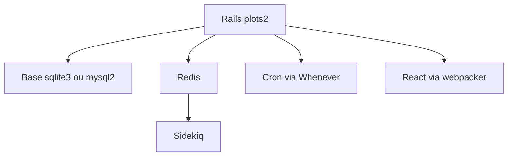

# publiclab/plots2

> Application Rails de la communauté Public Lab, mêlant blog de recherche, wiki et questions-réponses.

## Le problème
Une communauté de recherche environnementale a besoin d'un espace pour publier notes, documentation et échanges.

## Ce que ça fait vraiment
Gère notes de recherche, wiki avec révisions, étiquettes et groupes, questions-réponses, notifications par e-mail, recherche via une API, carte de localisation Leaflet et internationalisation. Réécrite en Rails en 2012 mais elle garde le modèle de données Drupal d'origine.

## Comment c'est branché
Schéma simplifié d'après la fiche, sans diagramme fourni.



## Essayer
```bash
bundle install
cp db/schema.rb.example db/schema.rb
rake db:setup
yarn install
passenger start
rails test
```

## Coût et pièges
Gratuit. Ruby 2.7.3, Redis et Sidekiq pour certaines fonctions ; avec sqlite3 certains tests échouent. Installation longue et ancienne (webpacker). 583 issues ouvertes.

## Ce que ce n'est pas
Pas un outil de données : un site communautaire, pas un CMS générique.

## Alternatives
Aucune alternative nommée dans le README.

## Pour toi
À ignorer : application web communautaire sans lien avec la data ou le MLOps.

