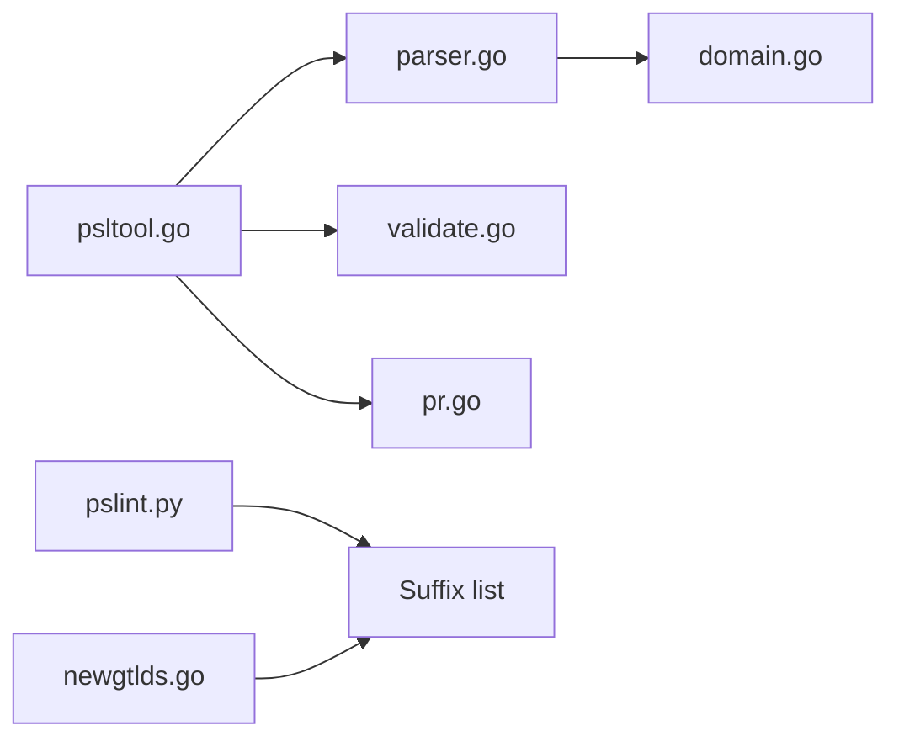

# publicsuffix/list

> The reference list of suffixes under which domain names can be registered, for web developers and browsers.

## The problem
Without a common list, it is impossible to know whether `co.uk` or `pvt.k12.ma.us` is a registrable domain: cookies and site boundaries become wrong.

## What it actually does
The repository contains the list itself, maintained by volunteers, and the tooling to modify it: a `psltool` CLI (Go) that parses, formats and validates the list, a syntax linter `pslint.py`, a generator of the gTLD list (`newgtlds.go`) and a private-domain checker. Contributions go through PRs that must follow a mandatory template.

## How it is wired


## Trying it
```bash
# Aucune commande d'installation dans le README :
# consulter https://publicsuffix.org/ et le wiki.
```

## Cost and gotchas
Free. Additions require a strict PR template, otherwise the PR is closed without follow-up; no support is offered to requesters.

## What it is not
Not a help desk: the README says so explicitly. Not a workaround for Cloudflare or AdSense subdomain limits. A malformed entry can break a site's cookies.

## Alternatives
No alternative named in the README.

## For you
Worth watching: you consume this list indirectly through your URL libraries, but you have no reason to integrate it yourself, except to register a domain in it.
