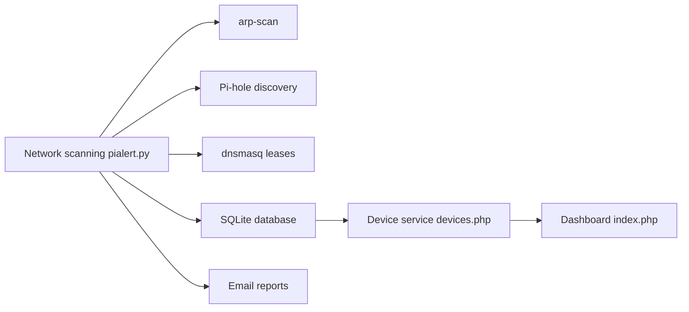

# pucherot/Pi.Alert

> Detector of unknown devices on a Wi-Fi or LAN network, for individuals and small networks.

## The problem
You don't know which devices connect to your home or lab network, nor when a device that is supposed to be always on disappears.

## What it actually does
A Python "back" part regularly scans the network, stores the results in SQLite and sends reports by e-mail. It detects new devices, reconnections, disconnections, absent "always connected" devices, and changes of local IP and Internet IP. A PHP "front" part displays inventory, sessions, events and presence. Three scan methods: arp-scan, then, optionally, Pi-hole and dnsmasq leases.

## How it is wired


## Trying it
```bash
curl -sSL https://github.com/pucherot/Pi.Alert/raw/main/install/pialert_install.sh | bash
curl -sSL https://github.com/pucherot/Pi.Alert/raw/main/install/pialert_update.sh | bash
```

## Cost and gotchas
Free. Designed for Raspberry Pi, "probably" compatible with other Linux distributions. Installation goes through a script that is downloaded and run directly: read it before running. Last push in February 2024, 124 open issues.

## What it is not
Not an IDS nor a firewall: it reports devices, it blocks nothing. It only sees what arp-scan, Pi-hole or dnsmasq expose. The author himself notes a limited level in Python, PHP and JavaScript.

## Alternatives
None cited in the README, apart from the Pi-hole and dnsmasq components it uses as sources.

## For you
Keep an eye on it: useful for a homelab, but the repository has not been updated for over a year and has no direct link with data/AI/MLOps work.
