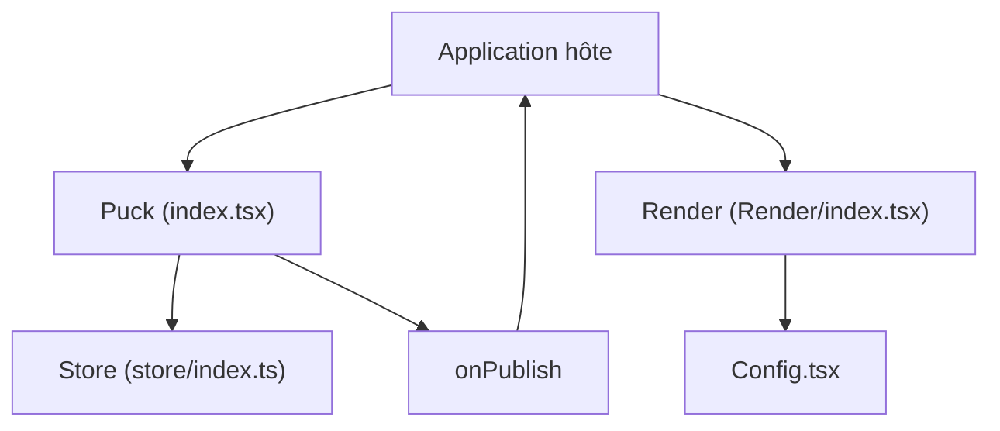

# puckeditor/puck

> A modular visual editor for React, letting your application offer drag-and-drop with your own components.

## The problem
Offering non-developers a page editor without locking your data into a visual CMS vendor.

## What it actually does
A `Puck` React component configured with a list of components and fields. It edits page data, calls `onPublish` so the application saves it, then `Render` displays the page. The repository contains Next.js and React Router recipes, a Contentful field and an AI handler that goes through Puck Cloud.

## How it is wired


## Trying it
```bash
npm i @puckeditor/core --save
npx create-puck-app my-app
```

## Cost and gotchas
Free, MIT license. You need Node and a React application. The repository's AI feature goes through Puck Cloud, which introduces a third-party service outside the main README.

## What it is not
Not a full CMS: you provide storage and hosting. Not useful outside React.

## Alternatives
- No alternative named in the README.

## For you
Ignore: relevant for a React front end with page editing, rarely for a data / AI profile, except for an internal tool to build.
