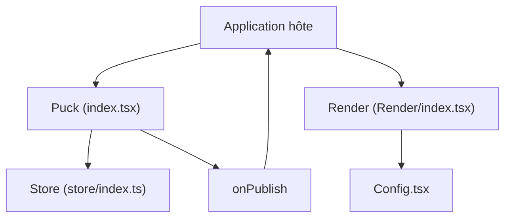

# puckeditor/puck

> Éditeur visuel modulaire pour React, qui permet à ton application d'offrir du glisser-déposer avec tes composants.

## Le problème
Offrir aux non-développeurs un éditeur de pages sans verrouiller ses données chez un fournisseur de CMS visuel.

## Ce que ça fait vraiment
Composant React `Puck` configuré par une liste de composants et de champs. Il édite des données de page, appelle `onPublish` pour que l'application les enregistre, puis `Render` affiche la page. Le dépôt contient des recettes Next.js et React Router, un champ Contentful et un gestionnaire d'IA qui passe par Puck Cloud.

## Comment c'est branché


## Essayer
```bash
npm i @puckeditor/core --save
npx create-puck-app my-app
```

## Coût et pièges
Gratuit, licence MIT. Il faut Node et une application React. La fonction d'IA du dépôt passe par Puck Cloud, ce qui introduit un service tiers hors du README principal.

## Ce que ce n'est pas
Pas un CMS complet : tu fournis le stockage et l'hébergement. Pas utile hors de React.

## Alternatives
- Aucune alternative nommée dans le README.

## Pour toi
À ignorer : pertinent pour un front React avec édition de pages, rarement pour un profil data / IA, sauf outil interne à construire.

