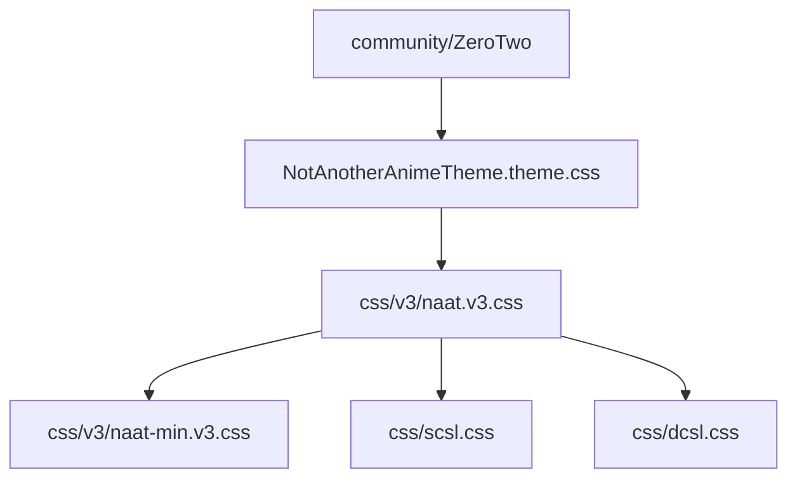

# puckzxz/NotAnotherAnimeTheme

> Customizable CSS theme for Discord, usable with BetterDiscord or Powercord.

## The problem
Discord's default interface offers little customization: background, server columns, scrollbars.

## What it actually does
A CSS theme whose main file loads the v3 stylesheets and variants for one to four server columns. Everything is configured in the theme file, including the background image. A community folder offers derived themes.

## How it is wired

## Trying it
For Powercord: create a NotAnotherAnimeTheme folder in powercord/src/Powercord/themes and download the repository into it. No command documented.

## Cost and gotchas
Free. Dark mode required, incompatible with minimal mode. A PayPal donation to the author is suggested.

## What it is not
Not an official theme: it depends on modifications to the Discord client (BetterDiscord, Powercord).

## Alternatives
No alternative named in the README.

## For you
Ignore: a visual Discord theme, unrelated to data, AI or MLOps work.
