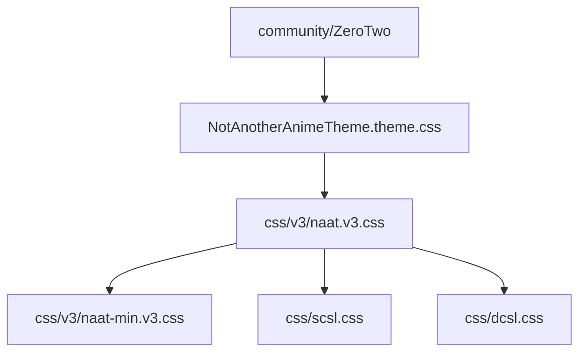

# puckzxz/NotAnotherAnimeTheme

> Thème CSS personnalisable pour Discord, utilisable avec BetterDiscord ou Powercord.

## Le problème
L'interface par défaut de Discord se règle peu : fond, colonnes de serveurs, barres de défilement.

## Ce que ça fait vraiment
Un thème CSS dont le fichier principal charge les feuilles v3 et des variantes pour une à quatre colonnes de serveurs. Tout se règle dans le fichier du thème, y compris l'image de fond. Un dossier community propose des thèmes dérivés.

## Comment c'est branché

## Essayer
Pour Powercord : créer un dossier NotAnotherAnimeTheme dans powercord/src/Powercord/themes et y télécharger le dépôt. Aucune commande documentée.

## Coût et pièges
Gratuit. Mode Dark requis, incompatible avec le mode minimal. Un don PayPal est suggéré à l'auteur.

## Ce que ce n'est pas
Pas un thème officiel : il dépend de modifications du client Discord (BetterDiscord, Powercord).

## Alternatives
Aucune alternative nommée dans le README.

## Pour toi
À ignorer : un thème visuel Discord, sans rapport avec un travail data, IA ou MLOps.

