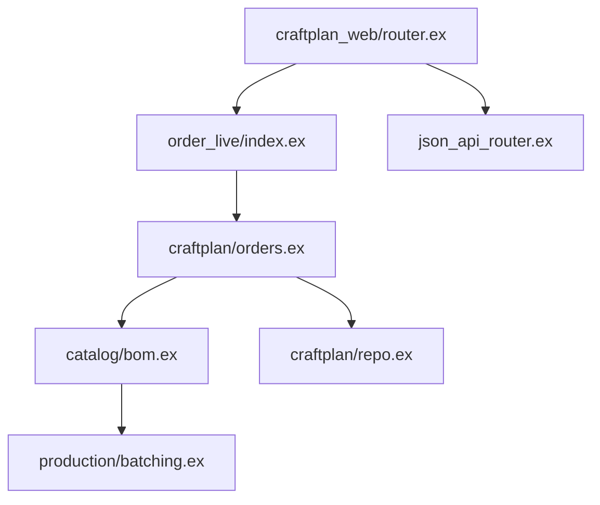

# puemos/craftplan

> Self-hosted management software for artisans: catalog, stock, orders, production, purchasing, CRM.

## The problem
A small workshop juggles several tools for its recipes, stock, orders and customers.

## What it actually does
An Elixir, Phoenix LiveView, Ash and PostgreSQL application. Versioned bills of materials with costs, batches and traceability, allergens, orders and invoices, purchasing, CRM, CSV import, JSON:API and GraphQL API, emails via SMTP or third-party services. The Phoenix router calls the Ash domains, persisted by Repo.

## How it is wired


## Trying it
```bash
curl -O https://raw.githubusercontent.com/puemos/craftplan/main/docker-compose.yml
curl -O https://raw.githubusercontent.com/puemos/craftplan/main/.env.example
cp .env.example .env
docker compose up -d
```

## Cost and gotchas
Free, but self-hosted: Docker, PostgreSQL, SeaweedFS and secrets to fill in .env. Email sending may go through a paid service.

## What it is not
Not a general-purpose ERP: it targets small-batch artisanal production. AGPL: code-sharing obligations if offered as a network service.

## Alternatives
No alternative named in the README.

## For you
Ignore: workshop management tool, unrelated to data / AI / MLOps work.
