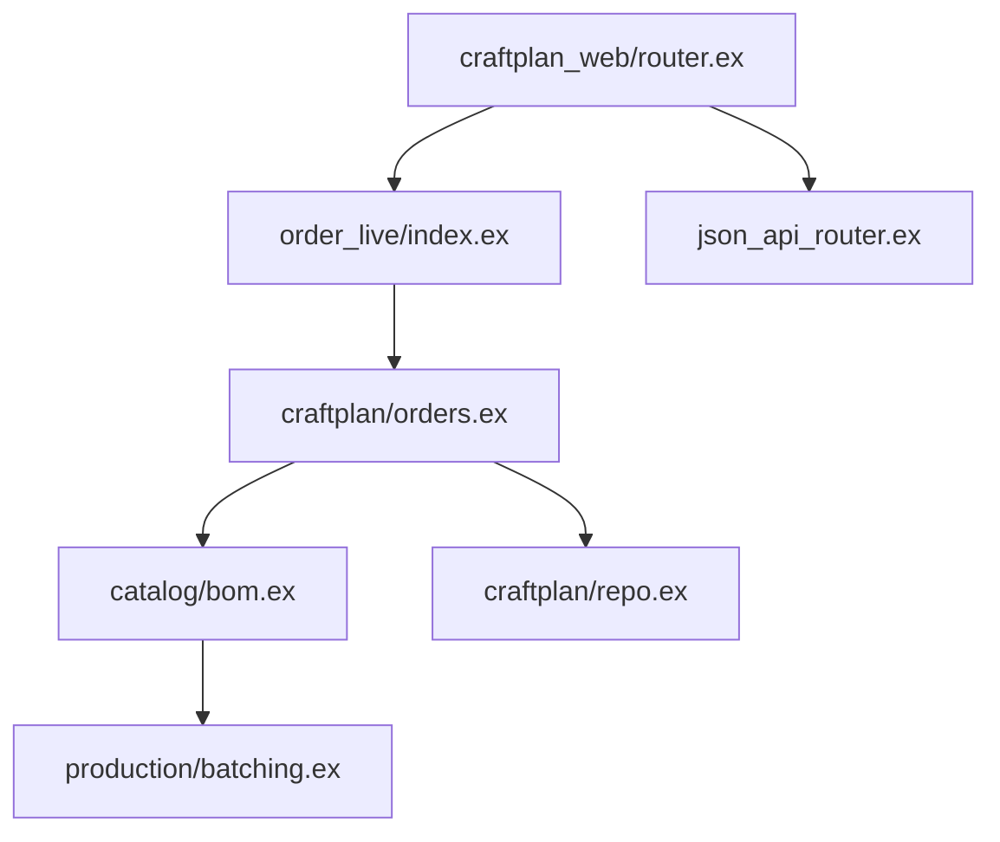

# puemos/craftplan

> Logiciel auto-hébergé de gestion pour artisans : catalogue, stocks, commandes, production, achats, CRM.

## Le problème
Un petit atelier jongle entre plusieurs outils pour ses recettes, stocks, commandes et clients.

## Ce que ça fait vraiment
Une application Elixir, Phoenix LiveView, Ash et PostgreSQL. Nomenclatures versionnées avec coûts, lots et traçabilité, allergènes, commandes et factures, achats, CRM, import CSV, API JSON:API et GraphQL, courriels via SMTP ou services tiers. Le routeur Phoenix appelle les domaines Ash, persistés par Repo.

## Comment c'est branché


## Essayer
```bash
curl -O https://raw.githubusercontent.com/puemos/craftplan/main/docker-compose.yml
curl -O https://raw.githubusercontent.com/puemos/craftplan/main/.env.example
cp .env.example .env
docker compose up -d
```

## Coût et pièges
Gratuit, mais auto-hébergé : Docker, PostgreSQL, SeaweedFS et secrets à renseigner dans .env. Les envois de courriel peuvent passer par un service payant.

## Ce que ce n'est pas
Pas un ERP généraliste : il vise la production artisanale en petits lots. AGPL : obligations de partage du code en cas de service réseau.

## Alternatives
Aucune alternative nommée dans le README.

## Pour toi
Ignorer : outil de gestion d'atelier, sans rapport avec un travail data / IA / MLOps.

