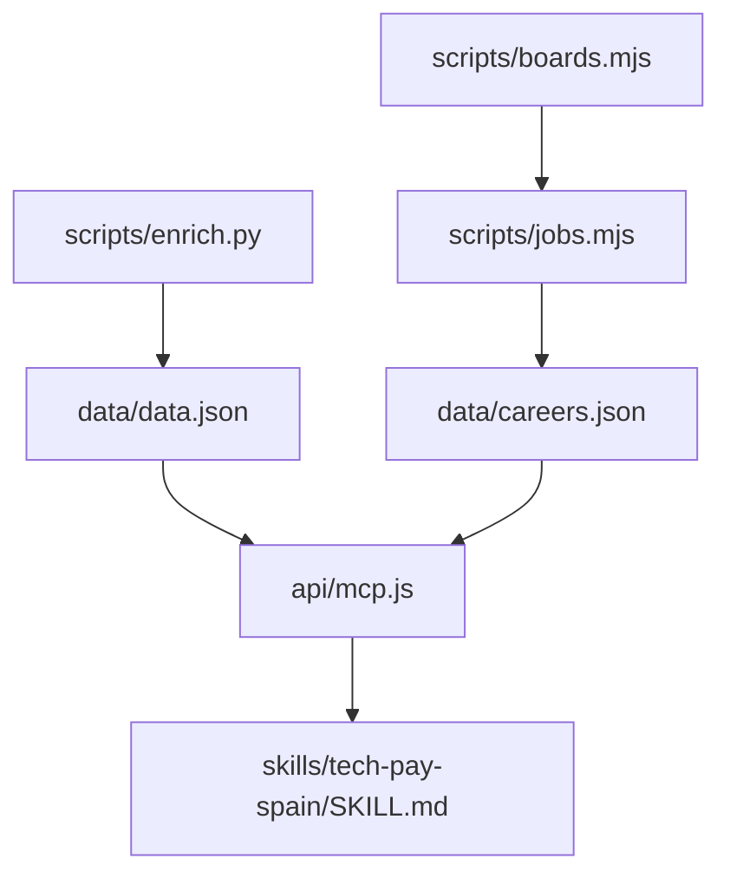

# pugarte7/spanish-top-tech-companies

> MCP server giving an agent tech salaries in Spain and open job listings, with application help.

## The problem
Comparing tech salaries and job offers in Spain requires digging through many portals and filling in forms by hand.

## What it actually does
The MCP server exposes eight tools (`find_jobs`, `job_questions`, `salary_stats`, `top_companies`, etc.). It crawls more than 400 job portals (Greenhouse, Workday, Lever…) every day and attaches to each offer the company's median salary from Levels.fyi. The agent can read the application form and fill it in, but nothing is sent without your approval.

## How it is wired



## Trying it
```bash
https://spanishtoptechcompanies.com/mcp
hermes skills install pugarte7/spanish-top-tech-companies/skills/tech-pay-spain
node scripts/mcp-stdio.mjs
```
(the first line is the URL to add as an MCP server in the agent)

## Cost and gotchas
Free, no key or sign-up. Depends on a site hosted by a single person and on Levels.fyi data, whose terms apply. Figures may be incomplete.

## What it is not
Not financial or legal advice (the README says so). Not an international tool: only offers workable from Spain are kept.

## Alternatives
No alternative named in the README.

## For you
Worth watching: interesting as an example of a data MCP server plus a job-application agent, useful only if you are looking for a tech job in Spain.
