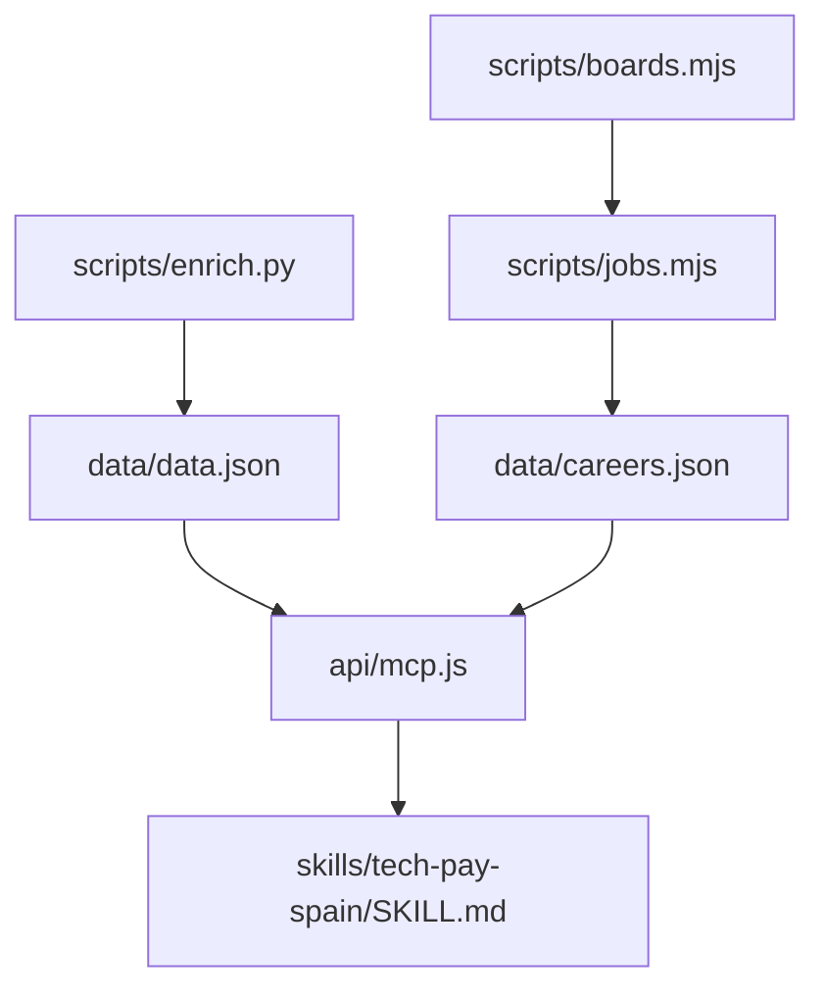

# pugarte7/spanish-top-tech-companies

> Serveur MCP donnant à un agent les salaires tech en Espagne et les offres ouvertes, avec aide à la candidature.

## Le problème
Comparer salaires et offres tech en Espagne exige de fouiller de nombreux portails et de remplir des formulaires à la main.

## Ce que ça fait vraiment
Le serveur MCP expose huit outils (`find_jobs`, `job_questions`, `salary_stats`, `top_companies`, etc.). Il rastrelle chaque jour plus de 400 portails d'emploi (Greenhouse, Workday, Lever…) et associe à chaque offre le salaire médian de l'entreprise issu de Levels.fyi. L'agent peut lire le formulaire de candidature et le remplir, mais rien n'est envoyé sans votre accord.

## Comment c'est branché



## Essayer
```bash
https://spanishtoptechcompanies.com/mcp
hermes skills install pugarte7/spanish-top-tech-companies/skills/tech-pay-spain
node scripts/mcp-stdio.mjs
```
(la première ligne est l'URL à ajouter comme serveur MCP dans l'agent)

## Coût et pièges
Gratuit, sans clé ni inscription. Dépend d'un site hébergé par une seule personne et des données Levels.fyi, dont les conditions s'appliquent. Les chiffres peuvent être incomplets.

## Ce que ce n'est pas
Pas un conseil financier ni juridique (le README le précise). Pas un outil international : seules les offres faisables depuis l'Espagne sont gardées.

## Alternatives
Aucune alternative nommée dans le README.

## Pour toi
À surveiller : intéressant comme exemple de serveur MCP de données plus agent de candidature, utile seulement si tu cherches du travail tech en Espagne.

