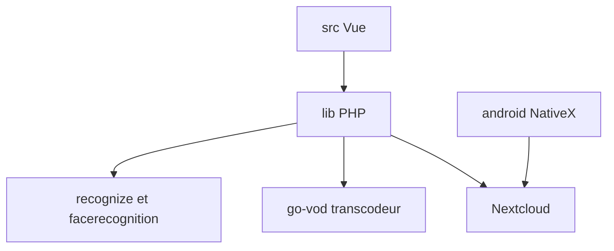

# pulsejet/memories

> Photo management app for Nextcloud: timeline, albums, map and AI tagging.

## The problem
The Nextcloud Photos app is limited for browsing, editing and organizing large collections.

## What it actually does
A timeline by Exif date, shareable albums, a map with reverse geocoding, batch metadata editing and archiving. HLS video transcoding goes through a Go service (go-vod). Tagging by people or objects relies on the recognize and facerecognition apps. It migrates from Nextcloud Photos and Google Takeout.

## How it is wired
Simplified diagram based on the sheet, no diagram provided.


## Trying it
```bash
php occ memories:index
make dev-setup
make watch-js
```

## Cost and gotchas
Free, AGPL-3.0, but you need a Nextcloud instance, install the app from its store and apply the recommended settings. Indexing existing photos requires running a command. 446 open issues.

## What it is not
Not a standalone application: without Nextcloud, it does not run. The README claims tests on over a million photos without providing the measurements.

## Alternatives
- Nextcloud Photos: the original app, from which Memories allows migration.

## For you
Ignore: a photo library extension for Nextcloud, with no role in a data, AI or MLOps pipeline.
