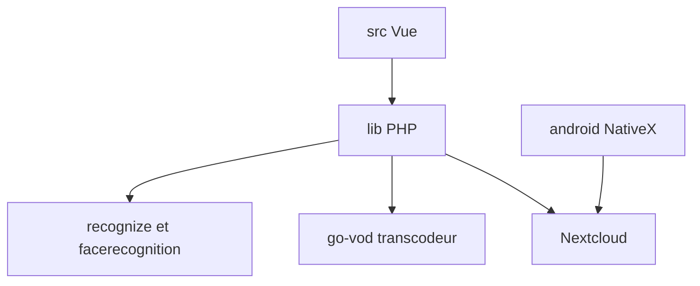

# pulsejet/memories

> Application de gestion de photos pour Nextcloud : chronologie, albums, carte et étiquetage IA.

## Le problème
L'appli Photos de Nextcloud est limitée pour parcourir, éditer et classer de grandes collections.

## Ce que ça fait vraiment
Une chronologie par date Exif, des albums partageables, une carte avec géocodage inverse, l'édition de métadonnées en lot et l'archivage. Le transcodage vidéo HLS passe par un service Go (go-vod). L'étiquetage par personnes ou objets s'appuie sur les applis recognize et facerecognition. Elle migre depuis Nextcloud Photos et Google Takeout.

## Comment c'est branché
Schéma simplifié d'après la fiche, sans diagramme fourni.


## Essayer
```bash
php occ memories:index
make dev-setup
make watch-js
```

## Coût et pièges
Gratuit, AGPL-3.0, mais il faut une instance Nextcloud, installer l'appli depuis son magasin et faire les réglages recommandés. L'indexation des photos existantes demande une commande à lancer. 446 issues ouvertes.

## Ce que ce n'est pas
Pas une application autonome : sans Nextcloud, elle ne tourne pas. Le README annonce des essais sur plus d'un million de photos sans fournir les mesures.

## Alternatives
- Nextcloud Photos : l'appli d'origine, dont Memories permet la migration.

## Pour toi
À ignorer : une extension de photothèque pour Nextcloud, sans rôle dans un pipeline data, IA ou MLOps.

