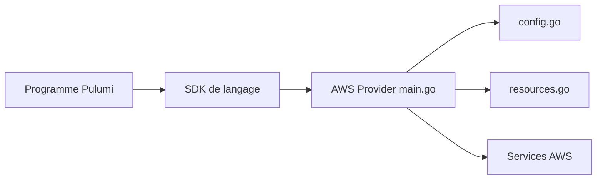

# pulumi/pulumi-aws

> Pulumi provider to describe and manage AWS resources in TypeScript, Python, Go, .NET or Java.

## The problem
Declaring AWS infrastructure in the console or in YAML is weakly typed and hard to factor out.

## What it actually does
Exposes all AWS resources (EC2, ECS, IAM, Lambda, API Gateway…) as generated typed SDKs, with convenience APIs such as `aws.lambda.CallbackFunction`. Configuration by region, profile, assumed role, custom endpoints. The provider is a Go binary built on the upstream provider.

## How it is wired


## Trying it
```bash
npm install @pulumi/aws
pip install pulumi_aws
go get github.com/pulumi/pulumi-aws/sdk/v7
dotnet add package Pulumi.Aws
```

## Cost and gotchas
The Pulumi CLI and AWS credentials are required; the resources created are billed by AWS. 391 open issues.

## What it is not
Not a standalone tool: without the Pulumi CLI and an AWS account, nothing runs. The README is a configuration reference, not a tutorial.

## Alternatives
No alternative cited in the README.

## For you
Worth watching: relevant if you provision MLOps infrastructure on AWS as code; otherwise useless.
