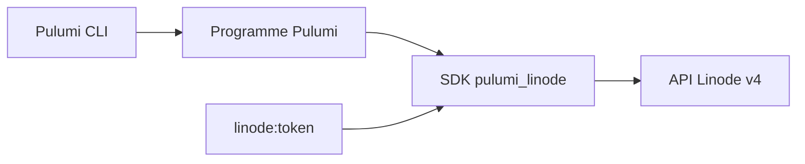

# pulumi/pulumi-linode

> Pulumi provider to declare Linode resources in TypeScript, Python, Go or .NET.

## The problem
Provisioning Linode servers by hand or with ad hoc scripts is not reproducible.

## What it actually does
Language packages for Pulumi that expose Linode resources. Configuration: API v4 token (`linode:token` or `LINODE_TOKEN`), optional URL and user-agent prefix.

## How it is wired
Simplified diagram based on the sheet, no diagram provided.



## Trying it
```bash
npm install @pulumi/linode
pip install pulumi_linode
go get github.com/pulumi/pulumi-linode/sdk/v4
dotnet add package Pulumi.Linode
```

## Cost and gotchas
The Linode resources you create are billed to you. You need an account, a token and the Pulumi CLI.

## What it is not
Not a standalone platform: it assumes Pulumi and a Linode account.

## Alternatives
No alternative named in the README.

## For you
Ignore: only useful if your infrastructure is on Linode with Pulumi.
