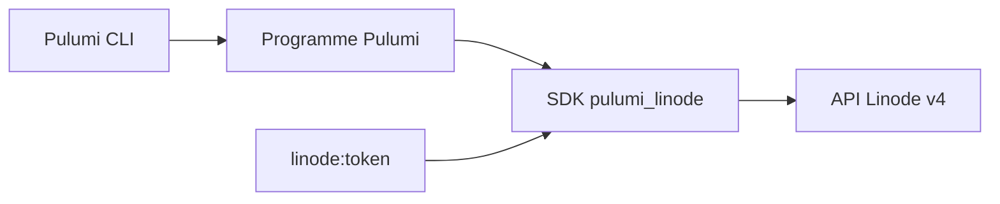

# pulumi/pulumi-linode

> Fournisseur Pulumi pour déclarer des ressources Linode en TypeScript, Python, Go ou .NET.

## Le problème
Provisionner des serveurs Linode à la main ou par scripts ad hoc n'est pas reproductible.

## Ce que ça fait vraiment
Paquets de langage pour Pulumi qui exposent les ressources Linode. Configuration : jeton API v4 (`linode:token` ou `LINODE_TOKEN`), URL et préfixe d'agent utilisateur optionnels.

## Comment c'est branché
Schéma simplifié d'après la fiche, sans diagramme fourni.



## Essayer
```bash
npm install @pulumi/linode
pip install pulumi_linode
go get github.com/pulumi/pulumi-linode/sdk/v4
dotnet add package Pulumi.Linode
```

## Coût et pièges
Les ressources Linode créées sont facturées à ta charge. Il faut un compte, un jeton et la CLI Pulumi.

## Ce que ce n'est pas
Pas une plateforme autonome : il suppose Pulumi et un compte Linode.

## Alternatives
Aucune alternative nommée dans le README.

## Pour toi
À ignorer : utile seulement si ton infra est sur Linode avec Pulumi.

