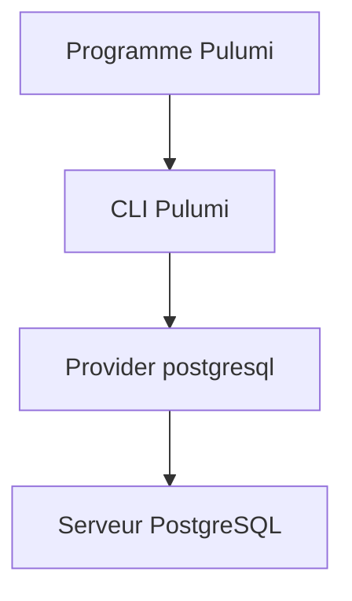

# pulumi/pulumi-postgresql

> Pulumi provider that manages PostgreSQL roles, databases and resources from code, for those doing infrastructure as code.

## The problem
Creating PostgreSQL roles, databases and permissions by hand or with scattered SQL scripts makes the state of the database hard to reproduce.

## What it actually does
Exposes PostgreSQL resources in the Pulumi languages (Node.js, Python, Go, .NET). It connects to an existing server via parameters: host, port, database, user, password, SSL mode, connection timeout, max connections, client certificate.

## How it is wired
Simplified diagram based on the sheet, no diagram provided.


## Trying it
```bash
npm install @pulumi/postgresql
pip install pulumi_postgresql
go get github.com/pulumi/pulumi-postgresql/sdk/v3
dotnet add package Pulumi.Postgresql
```

## Cost and gotchas
You need the Pulumi CLI and a reachable PostgreSQL server. With a non-superuser account (RDS), `superuser` must be set to `false` and some features are disabled.

## What it is not
Not a PostgreSQL server nor a data migration tool: it describes database objects, nothing more.

## Alternatives
No alternative named in the README.

## For you
Worth watching if you already manage your databases with Pulumi; otherwise of no interest for everyday data work.
