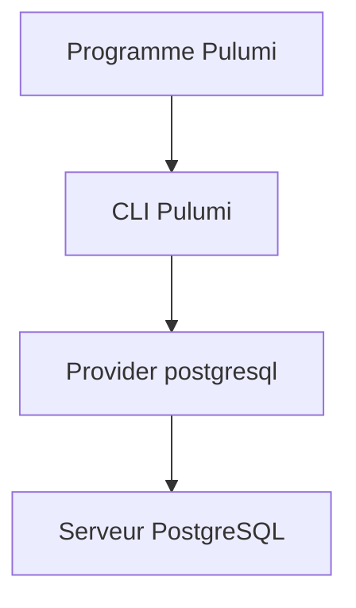

# pulumi/pulumi-postgresql

> Fournisseur Pulumi qui gère rôles, bases et ressources PostgreSQL depuis du code, pour ceux qui font de l'infra as code.

## Le problème
Créer rôles, bases et droits PostgreSQL à la main ou par scripts SQL dispersés rend l'état de la base difficile à reproduire.

## Ce que ça fait vraiment
Expose les ressources PostgreSQL dans les langages Pulumi (Node.js, Python, Go, .NET). Il se connecte à un serveur existant via des paramètres : hôte, port, base, utilisateur, mot de passe, mode SSL, délai de connexion, connexions max, certificat client.

## Comment c'est branché
Schéma simplifié d'après la fiche, sans diagramme fourni.


## Essayer
```bash
npm install @pulumi/postgresql
pip install pulumi_postgresql
go get github.com/pulumi/pulumi-postgresql/sdk/v3
dotnet add package Pulumi.Postgresql
```

## Coût et pièges
Il faut la CLI Pulumi et un serveur PostgreSQL accessible. Avec un compte non superutilisateur (RDS), `superuser` doit être mis à `false` et certaines fonctions sont désactivées.

## Ce que ce n'est pas
Pas un serveur PostgreSQL ni un outil de migration de données : il décrit des objets de base, rien de plus.

## Alternatives
Aucune alternative nommée dans le README.

## Pour toi
À surveiller si tu gères déjà tes bases avec Pulumi ; sinon sans intérêt pour du travail data courant.

