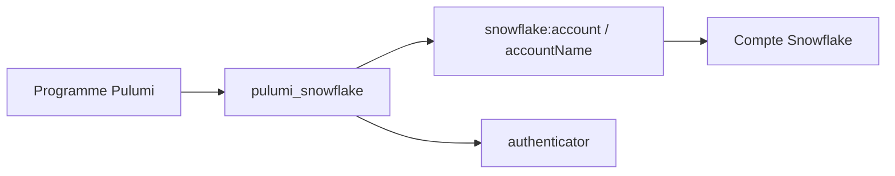

# pulumi/pulumi-snowflake

> Pulumi provider to manage Snowflake resources as infrastructure as code.

## The problem
Objects in a Snowflake warehouse (roles, warehouses, grants) are hard to manage by hand and without history.

## What it actually does
Provider available in Node.js, Python, Go and .NET. Varied authentication: password, private key, OAuth, external browser, Okta, programmatic access token, workload identity. Parameters can also be read from `SNOWFLAKE_*` variables or a `~/.snowflake/config` profile.

## How it is wired
Simplified diagram based on the sheet, no diagram provided.


## Trying it
```bash
npm install @pulumi/snowflake
pip install pulumi_snowflake
go get github.com/pulumi/pulumi-snowflake/sdk
dotnet add package Pulumi.Snowflake
```

## Cost and gotchas
Requires a (paid) Snowflake account and credentials. The README does not introduce Pulumi.

## What it is not
Not a query connector: it manages configuration, not data.

## Alternatives
None named in the README.

## For you
Watch: useful for versioning a Snowflake warehouse in an MLOps approach, if you already use Pulumi.
