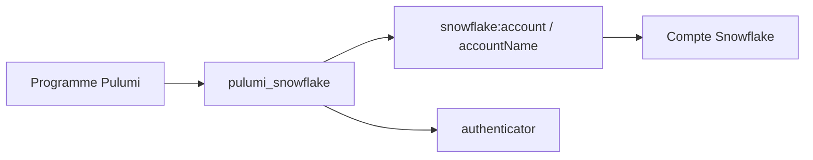

# pulumi/pulumi-snowflake

> Fournisseur Pulumi pour gérer des ressources Snowflake en infrastructure as code.

## Le problème
Les objets d'un entrepôt Snowflake (rôles, entrepôts, droits) se gèrent mal à la main et sans historique.

## Ce que ça fait vraiment
Fournisseur disponible en Node.js, Python, Go et .NET. Authentification variée : mot de passe, clé privée, OAuth, navigateur externe, Okta, jeton d'accès programmatique, identité de charge de travail. Les paramètres se lisent aussi dans des variables `SNOWFLAKE_*` ou un profil `~/.snowflake/config`.

## Comment c'est branché
Schéma simplifié d'après la fiche, sans diagramme fourni.


## Essayer
```bash
npm install @pulumi/snowflake
pip install pulumi_snowflake
go get github.com/pulumi/pulumi-snowflake/sdk
dotnet add package Pulumi.Snowflake
```

## Coût et pièges
Compte Snowflake (payant) et identifiants requis. Le README ne présente pas Pulumi.

## Ce que ce n'est pas
Pas un connecteur de requêtes : il gère la configuration, pas les données.

## Alternatives
Aucune nommée dans le README.

## Pour toi
À surveiller : utile pour versionner un entrepôt Snowflake dans une démarche MLOps, si tu utilises déjà Pulumi.

