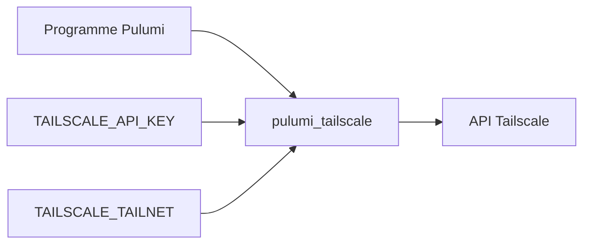

# pulumi/pulumi-tailscale

> Pulumi provider to manage Tailscale resources as infrastructure as code.

## The problem
Configuring a Tailscale network by hand in the admin interface is hard to reproduce.

## What it actually does
Resource provider available in Node.js, Python, Go and .NET. It authenticates with an API key (`tailscale:apiKey`) or an OAuth client, on a given tailnet (`tailscale:tailnet`). Resource details are in the provider's documentation.

## How it is wired
Simplified diagram based on the sheet, no diagram provided.


## Trying it
```bash
npm install @pulumi/tailscale
pip install pulumi_tailscale
go get github.com/pulumi/pulumi-tailscale/sdk
dotnet add package Pulumi.Tailscale
```

## Cost and gotchas
Requires a Tailscale account and an API key or OAuth client; Pulumi itself is not described in the README.

## What it is not
Not a Tailscale client nor a VPN: it drives the network's administration API.

## Alternatives
None named in the README.

## For you
Ignore: only useful if you already manage your Tailscale network with Pulumi, with no direct data/AI stake.
