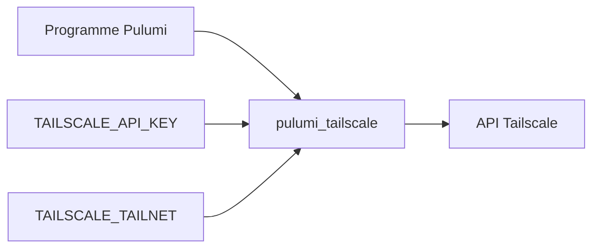

# pulumi/pulumi-tailscale

> Fournisseur Pulumi pour gérer des ressources Tailscale en infrastructure as code.

## Le problème
Configurer un réseau Tailscale à la main dans l'interface d'administration est peu reproductible.

## Ce que ça fait vraiment
Fournisseur de ressources disponible en Node.js, Python, Go et .NET. Il s'authentifie par clé d'API (`tailscale:apiKey`) ou par client OAuth, sur un tailnet donné (`tailscale:tailnet`). Le détail des ressources se trouve dans la documentation du fournisseur.

## Comment c'est branché
Schéma simplifié d'après la fiche, sans diagramme fourni.


## Essayer
```bash
npm install @pulumi/tailscale
pip install pulumi_tailscale
go get github.com/pulumi/pulumi-tailscale/sdk
dotnet add package Pulumi.Tailscale
```

## Coût et pièges
Compte Tailscale et clé d'API ou client OAuth requis ; Pulumi lui-même n'est pas décrit dans le README.

## Ce que ce n'est pas
Pas un client Tailscale ni un VPN : il pilote l'API d'administration du réseau.

## Alternatives
Aucune nommée dans le README.

## Pour toi
À ignorer : utile seulement si tu gères déjà ton réseau Tailscale avec Pulumi, sans enjeu data/IA direct.

