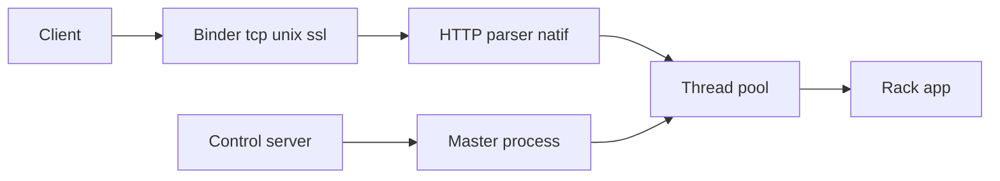

# puma/puma

> Multi-threaded, multi-process Ruby/Rack HTTP server, the default server of Rails.

## The problem
A Rack application must serve several requests in parallel without requiring a reverse proxy.

## What it actually does
Thread pool (default `0:16`, `0:5` on MRI), cluster mode by forking workers, native SSL with cipher options, hot restart, control server (`pumactl`), lifecycle hooks. HTTP parser inherited from Mongrel as a native extension.

## How it is wired


## Trying it
```bash
gem install puma
puma
puma -t 8:32 -w 3
```

## Cost and gotchas
Free. GVL ceiling on MRI; cluster mode not supported on Windows and JRuby; when forking, close the master's sockets beforehand (`before_fork`).

## What it is not
Not a web framework nor a Python application server. Serves only Ruby/Rack, HTTP 1.1.

## Alternatives
Unicorn and NGINX are cited as references for hot restart; not presented as alternatives.

## For you
Ignore: a Ruby server, unrelated to a Python data/AI/MLOps stack.
