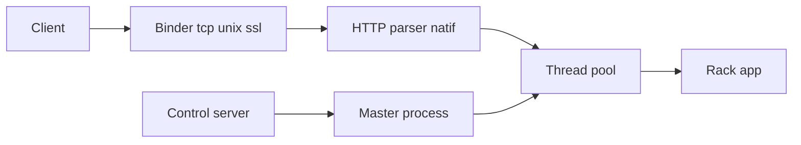

# puma/puma

> Serveur HTTP Ruby/Rack multi-thread et multi-processus, serveur par défaut de Rails.

## Le problème
Une application Rack doit servir plusieurs requêtes en parallèle sans proxy inverse obligatoire.

## Ce que ça fait vraiment
Pool de threads (par défaut `0:16`, `0:5` sous MRI), mode cluster par fork de workers, SSL natif avec options de chiffrement, redémarrage à chaud, serveur de contrôle (`pumactl`), hooks de cycle de vie. Parseur HTTP hérité de Mongrel en extension native.

## Comment c'est branché


## Essayer
```bash
gem install puma
puma
puma -t 8:32 -w 3
```

## Coût et pièges
Gratuit. Plafond GVL sur MRI ; cluster non supporté sous Windows et JRuby ; fork : fermer les sockets du maître avant (`before_fork`).

## Ce que ce n'est pas
Pas un framework web ni un serveur d'applications Python. Ne sert que Ruby/Rack, HTTP 1.1.

## Alternatives
Unicorn et NGINX sont cités comme références du redémarrage à chaud ; pas présentés comme alternatives.

## Pour toi
À ignorer : serveur Ruby, sans lien avec une stack data/IA/MLOps en Python.

