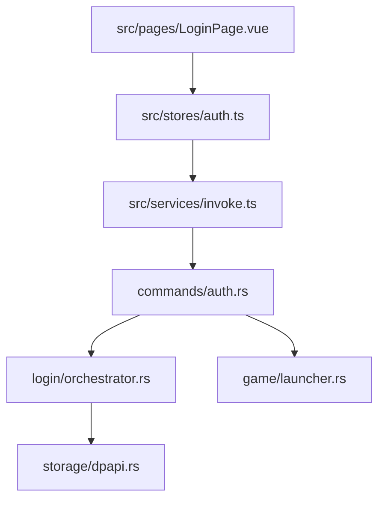

# pungin/Beanfun

> Unofficial third-party launcher for Gamania (Beanfun) games, on Windows.

## The problem
The official Beanfun client is restrictive; this launcher handles login and game startup differently.

## What it actually does
A Tauri v2 application: a Vue interface calls Rust commands via invoke.ts. An orchestrator handles login, DPAPI-encrypted storage keeps the accounts, then the launcher starts the game with Locale Remulator (LRProc.exe and hook DLLs generated alongside).

## How it is wired


## Trying it
```bash
npm install
npm run tauri dev
```
Otherwise, binaries are on the releases page.

## Cost and gotchas
Free. Windows 10+ and WebView2. No license is declared. Rust and Node 22 to build. The README, in Chinese, warns that it is unofficial and that logging in through a third party is a risk: you enter your game credentials in it.

## What it is not
Not an official client nor a tool for anything other than these games. Hook DLLs are injected into the game.

## Alternatives
MapleLink, a sibling launcher for MapleStory only, cited in the README.

## For you
Ignore: a game launcher, unrelated to data, AI or MLOps work, and without a license.
